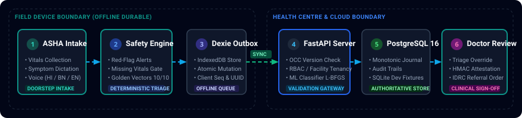
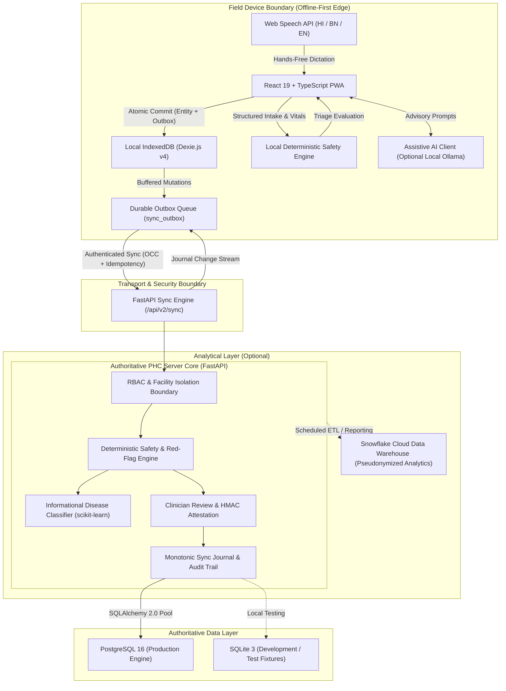
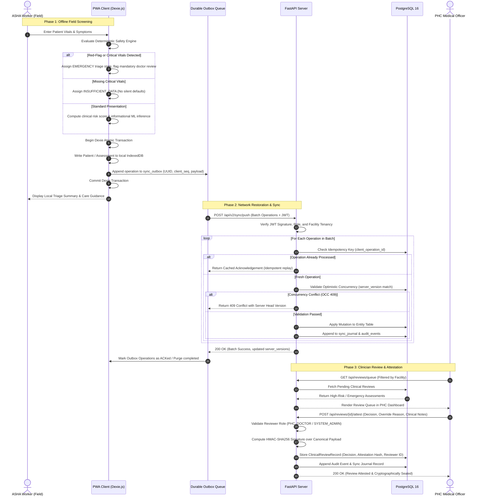

# RapiDChecK — RuralHealth AI

> **Clinically Governed, Offline-First Disease Triage and Rural Healthcare Access Platform**  
> Designed for Accredited Social Health Activist (ASHA) and Auxiliary Nurse Midwife (ANM) frontline health workers, Primary Health Centre (PHC) medical officers, and district health authorities across low-connectivity regions of India.

[](https://fastapi.tiangolo.com)
[](https://react.dev/)
[](https://www.typescriptlang.org/)
[](https://www.postgresql.org/)
[](https://dexie.org/)
[](https://scikit-learn.org/)
[](https://www.docker.com/)

---

### Important Clinical Governance Notice
> **Clinical Decision-Support System Notice:** RapiDChecK / RuralHealth AI is an assistive clinical decision-support and triage platform. It is designed to assist trained healthcare workers and medical officers in structured screening, risk stratification, and continuity of care. It **does not** provide autonomous medical diagnoses and is **not a replacement** for formal clinical evaluation, laboratory diagnostics, or licensed physician judgment. All emergency screenings require immediate physical escalation to an appropriate healthcare facility.

---

## Documentation Quick Links

- [System Architecture & Engineering Specification](docs/PROJECT.md)
- [Database Schema & Migration Guide](docs/DATABASE.md)
- [Authentication, RBAC & Cryptographic Attestation](docs/AUTH.md)
- [Feature Capabilities & Clinical Ruleset Engine](docs/FEATURE.md)
- [Validation Records & Test Traceability Matrix](docs/validation/requirements-test-matrix.md)
- [Snowflake Population Health Pipeline](docs/SNOWFLAKE_INTEGRATION.md)

---

## Table of Contents

1. [Executive Summary](#1-executive-summary)
2. [System Architecture & Workflow](#2-system-architecture--workflow)
   - [Workflow Pipeline Overview](#21-workflow-pipeline-overview)
   - [High-Level Component Architecture](#22-high-level-component-architecture)
   - [Offline Screening & Sync Lifecycle Sequence](#23-offline-screening--sync-lifecycle-sequence)
3. [Core Capabilities](#3-core-capabilities)
   - [3.1 Offline-First Durability & Outbox Synchronization](#31-offline-first-durability--outbox-synchronization)
   - [3.2 Clinical Triage & Deterministic Safety Engine](#32-clinical-triage--deterministic-safety-engine)
   - [3.3 Authentication, Authorization & Cryptographic Governance](#33-authentication-authorization--cryptographic-governance)
   - [3.4 Assistive AI Architecture & Governance](#34-assistive-ai-architecture--governance)
   - [3.5 Multilingual Interface & Accessibility](#35-multilingual-interface--accessibility)
   - [3.6 Operational IDRC Referrals & Healthcare Resources](#36-operational-idrc-referrals--healthcare-resources)
4. [Technology Stack](#4-technology-stack)
5. [Repository Structure](#5-repository-structure)
6. [Quick Start with Docker Compose](#6-quick-start-with-docker-compose)
7. [Local Development Setup](#7-local-development-setup)
   - [Backend Service (FastAPI)](#71-backend-service-fastapi)
   - [Frontend Client (React + Vite PWA)](#72-frontend-client-react--vite-pwa)
   - [Optional Local AI Runtime (Ollama + Gemma 3 270M)](#73-optional-local-ai-runtime-ollama--gemma-3-270m)
8. [Environment Variable Reference](#8-environment-variable-reference)
9. [Database Architecture & Persistence](#9-database-architecture--persistence)
10. [API Specification](#10-api-specification)
11. [Machine Learning Disease Classifier](#11-machine-learning-disease-classifier)
12. [Testing & Verification](#12-testing--verification)
13. [Security & Privacy Engineering](#13-security--privacy-engineering)
14. [Deployment & Reverse Proxy Configuration](#14-deployment--reverse-proxy-configuration)
15. [Limitations & Project Roadmap](#15-limitations--project-roadmap)
16. [Contributing & License](#16-contributing--license)

---

## 1. Executive Summary

Primary healthcare delivery across rural India encounters structural obstacles: intermittent electrical power, absent or erratic cellular connectivity, high patient-to-doctor ratios, and vast geographical distances separating remote villages from Sub-Centres (SC), Primary Health Centres (PHC), and Community Health Centres (CHC).

Frontline community health workers—principally Accredited Social Health Activists (ASHAs) and Auxiliary Nurse Midwives (ANMs)—conduct household visits to screen for maternal complications, non-communicable diseases (NCDs), infectious illnesses, and acute pediatric emergencies. When paper logs or fragile cloud-dependent mobile applications fail due to lack of network access, critical screening data is delayed, resulting in missed windows for early clinical intervention.

**RapiDChecK / RuralHealth AI** bridges this operational gap through a **clinically governed, offline-first digital triage architecture**:

- **Doorstep Digital Intake:** A Progressive Web App (PWA) operating entirely in offline field conditions on standard tablet hardware.
- **Deterministic Clinical Safety Gates:** Strict rule-based evaluations execute directly on-device. Missing vitals never silently default to normal values; critical presentations immediately trigger emergency short-circuits.
- **Durable Local Outbox:** Patient enrollments and clinical encounters are committed atomically to browser IndexedDB storage and queued in a durable outbox.
- **Guaranteed Synchronization:** When connectivity is re-established at the health sub-centre or PHC, outbox batches sync via authenticated HTTP endpoints utilizing Optimistic Concurrency Control (OCC) and client operation idempotency to prevent record corruption or duplicate submissions.
- **Physician Governance & Cryptographic Attestation:** Medical officers review high-risk screenings in a dedicated triage queue, retain authority to override assessments with audited clinical rationales, and seal decisions with server-side HMAC-SHA256 signatures.
- **Operational Referrals:** Standardized inter-facility transfer lifecycle (`REQUESTED` $\rightarrow$ `APPROVED` $\rightarrow$ `REFERRED` $\rightarrow$ `IN_PROGRESS` $\rightarrow$ `COMPLETED`), separating operational referral logistics from read-only population health surveillance.

### User Personas and Workflow Boundaries

| Persona | Operational Context | Primary Responsibilities & Permitted Actions |
| :--- | :--- | :--- |
| **ASHA / ANM Worker** | Village habitations, doorstep screenings, Sub-Centres | Registers patients, collects vital signs and symptom histories, conducts offline screenings, initiates urgent referral requests. *Strictly restricted from clinical overrides.* |
| **PHC Medical Officer** | Primary Health Centre outpatient clinics | Reviews referred screenings in the triage queue, conducts clinical examinations, attests decisions with cryptographic signatures, adjusts triage priorities with documented justifications, manages referral transitions. |
| **District Health Officer / CMO** | District Headquarters, Chief Medical Office | Reviews aggregate epidemiological indicators, monitors facility screening volumes, conducts audit trail inspections, allocates clinical resources across blocks. |
| **System Administrator** | Server infrastructure and devops | Manages identity directory, assigns facility tenancies, provisions cryptographic keys, oversees database maintenance and backups. |

---

## 2. System Architecture & Workflow

### 2.1 Workflow Pipeline Overview

The following diagram illustrates the progressive clinical and architectural stages from frontline village screening to server attestation:



---

### 2.2 High-Level Component Architecture

The platform architecture enforces a strict separation between client-side edge computing and the centralized clinical governance backend:



---

### 2.3 Offline Screening & Sync Lifecycle Sequence

This sequence details the interaction pattern during an offline screening event, local atomic commitment, network reconnection, and physician review:



---

## 3. Core Capabilities

### 3.1 Offline-First Durability & Outbox Synchronization

The platform is designed to operate continuously under zero-connectivity field conditions without losing entered data:

1. **Single-Transaction Atomicity:** Domain entity mutations (patients, assessments, appointments, referrals) and their corresponding sync outbox entries are committed within a single atomic IndexedDB transaction via `db.transaction('rw', [...])`. If either write fails, the entire transaction rolls back.
2. **Durable Outbox Queue:** Outbox records carry a client-generated UUID `operation_id`, device fingerprint `device_id`, and a strictly increasing integer sequence `client_sequence`.
3. **Idempotent Retries:** Network timeouts occurring after the server commits a transaction but before the client receives the response do not cause duplicate database rows. The server records processed operation IDs in an `idempotency_log` table and replays the original response on identical retries.
4. **Optimistic Concurrency Control (OCC):** Updates transmit the `server_version` upon which the edit was based. If a concurrent update modified the record on another device, the server rejects the stale update with an HTTP `409 Conflict`, preserving server state against silent overwrite.
5. **Soft Deletions & Tombstones:** Record deletions assign `is_deleted = 1` and update the entity timestamp. Deletion tombstones propagate through the sync journal, ensuring records removed on one device are reliably removed across all nodes.
6. **Cursor-Bounded Pull Sync:** Devices retrieve incremental updates using a cursor (`since_seq`). Only mutations occurring after the requested sequence number are transmitted, conserving cellular bandwidth.

---

### 3.2 Clinical Triage & Deterministic Safety Engine

To ensure clinical safety, the platform separates deterministic triage rules from statistical machine learning predictions:

- **Uncertainty & Incomplete Data Safety:** Missing physiological parameters (such as pulse rate, systolic blood pressure, or oxygen saturation) **never silently default to normal reference values**. When critical parameters are omitted, the engine assigns `uncertainty_state = "INSUFFICIENT_DATA"` and suppresses automated risk scoring.
- **Deterministic Emergency Short-Circuits:** Acute, life-threatening symptoms and vital sign thresholds bypass statistical risk models entirely. Presentations such as hypertensive crisis ($BP \ge 180/120\text{ mmHg}$), acute chest pain with diaphoresis, severe hypoxemia ($SpO_2 < 90\%$), diabetic coma, or postpartum hemorrhage immediately trigger:
  $$\text{triage\_state} = \text{"EMERGENCY"}, \quad \text{is\_emergency} = 1, \quad \text{requires\_doctor\_review} = 1$$
- **Cross-Platform Golden Vectors:** A suite of 10 multi-condition canonical patient profiles (`test_golden_vectors.py` and `test_golden_vectors.js`) validates that identical vital signs and symptoms generate mathematically and clinically identical triage outputs across both the Python backend and TypeScript client engines.
- **Informational ML Guardrails:** Statistical classifications provided by the machine learning model are labeled as informational decision-support aids. The system prevents ML predictions from downgrading or overriding deterministic emergency rules.

---

### 3.3 Authentication, Authorization & Cryptographic Governance

The security model protects sensitive clinical records and prevents unauthorized privilege escalation:

- **Password Hashing:** Implemented in [`backend/auth_service.py`](Health-AI-main/backend/auth_service.py) using PBKDF2-HMAC-SHA256 with 600,000 iterations and a 16-byte cryptographically secure random salt generated via `secrets.token_bytes(16)`.
- **JWT Claims Verification:** Bearer tokens are signed via HMAC-SHA256 (PyJWT) and carry explicit claims: subject `sub`, `username`, `role`, `facility_id`, issuer `iss` (`rapidcheck.internal`), audience `aud` (`rapidcheck-clinical-workforce`), and expiration timestamp `exp`.
- **Role-Based Access Control (RBAC):** Permissions are strictly bound to operational roles:
  - `ASHA_WORKER`: Create/read patients, create assessments, create/read referrals, read health resources, push/pull sync. *No permission to update referrals or perform clinical reviews.*
  - `PHC_DOCTOR`: Full clinical assessment access, manage appointments, review queue access, perform/override clinical reviews, update referral status, manage health resources.
  - `DISTRICT_OFFICER`: Read-only aggregate audit log review, district analytics access, review queue visibility.
  - `SYSTEM_ADMIN`: User lifecycle management, tenancy configuration, master audit log access.
- **Multi-Tenant Facility Isolation:** Medical officers and health workers are restricted to records originating within, or referred to, their registered facility boundary (`facility_id`). Cross-facility access attempts return HTTP `403 Forbidden`.
- **Server-Side Cryptographic Attestation (HMAC-SHA256):** When a physician submits a review or clinical override, the server computes a signature over a canonical serialization payload:
  $$\text{HMAC-SHA256}(K_{review}, \quad \text{review\_id} \,|\, \text{assessment\_id} \,|\, \text{reviewer\_id} \,|\, \text{decision} \,|\, \text{timestamp} \,|\, \text{override\_reason} \,|\, \text{ruleset\_version})$$
  Any downstream tampering with the attestation record, decision, or justification string invalidates verification.

---

### 3.4 Assistive AI Architecture & Governance

The platform incorporates an optional local AI assistant configured to run without transmitting health data to third-party commercial cloud APIs:

- **Local Inference Pipeline:**
  $$\text{React Client} \xrightarrow[\text{Bearer JWT}]{\text{POST /api/ai/chat}} \text{FastAPI Core} \xrightarrow[\text{httpx async}]{\text{Local HTTP}} \text{Ollama Runtime} \longrightarrow \text{Gemma 3 270M}$$
- **Automated PII Scrubbing:** All input prompts undergo client-side and backend regex sanitization before inference. Patient names, phone numbers, ABHA IDs, village habitations, and dates of birth are stripped or replaced with placeholder tokens. Full prompts and patient identifiers are never committed to disk logs.
- **Graceful Offline Degradation:** If the Ollama runtime is stopped or unavailable, the backend returns a structured connection error. All primary clinical workflows—screening, local triage, outbox sync, patient directories, and clinician reviews—continue operating normally.
- **Governance Boundary:** The AI model is strictly informational (providing dietary advice, clinical terminology explanations, or workflow navigation hints). It cannot compute, adjust, or override clinical risk scores or referral orders.

---

### 3.5 Multilingual Interface & Accessibility

To support frontline workers operating in linguistically diverse districts:

- **Localized Interfaces:** The client interface supports **English**, **Hindi (हिंदी)**, and **Bengali (বাংলা)**. Language preferences persist in local browser storage.
- **Voice Dictation (Speech-to-Text):** Frontline workers can dictate symptom narratives hands-free using the browser's native **Web Speech API** configured for Indian regional accents (`hi-IN`, `bn-IN`, `en-IN`).
- **Low-Literacy Clinical Visuals:** Color-coded clinical risk badges (High/Emergency: Rose, Moderate: Amber, Low: Emerald, Insufficient Data: Violet) and visual health status icons enable rapid assessment recognition under high-throughput field conditions.

---

### 3.6 Operational IDRC Referrals & Healthcare Resources

- **Independent Referral Module:** Operational referral management is maintained as an independent module ([`IdrcReferralsPage.tsx`](Health-AI-main/frontend/src/components/referrals/IdrcReferralsPage.tsx)) distinct from read-only population analytics ([`AnalysisPage.tsx`](Health-AI-main/frontend/src/components/analysis/AnalysisPage.tsx)).
- **Validated State Machine:** Referral transitions follow a strict lifecycle:
  $$\text{REQUESTED} \longrightarrow \text{APPROVED} \longrightarrow \text{REFERRED} \longrightarrow \text{IN\_PROGRESS} \longrightarrow \text{COMPLETED}$$
  Terminal statuses (`COMPLETED`, `CANCELLED`) cannot transition backwards.
- **Duplicate Prevention:** The backend checks for existing active referrals for the same patient and destination facility, preventing duplicate transfer requests.
- **Healthcare Resource Directory:** Curated directory of clinical guidelines, emergency contact numbers, and district diagnostic facilities categorized by topic and target audience.

---

## 4. Technology Stack

| Architectural Layer | Technology | Manifest Version | Responsibility & Implementation Scope |
| :--- | :--- | :--- | :--- |
| **Frontend Framework** | React | `^19.2.8` | Component architecture, virtual DOM rendering, state management |
| **Language (Client)** | TypeScript | `~6.0.2` | Static type safety across client models, forms, and API clients |
| **Build Tool & Bundler** | Vite | `^8.2.0` | Client bundling, HMR dev server, PWA asset compilation |
| **Styling & Design System** | Tailwind CSS | `^4.3.3` | Utility-first responsive clinical design system, dark/light modes |
| **Client Database** | Dexie.js (IndexedDB) | `^4.4.4` | Offline transactional persistence, client schema indexing (v7) |
| **Data Visualization** | Recharts | `^3.10.1` | Client-side epidemiological charts, risk distribution graphs |
| **Mapping & Location** | Leaflet / React-Leaflet | `^1.9.4` / `^5.0.0` | Offline-friendly hospital mapping with Google Maps API fallback |
| **PWA Service Worker** | Vite Plugin PWA (Workbox) | `^1.3.0` | Static asset precaching and Progressive Web App manifest |
| **Backend Framework** | FastAPI | `>=0.110.0` | Asynchronous RESTful API framework, dependency injection, OpenAPI |
| **ASGI Web Server** | Uvicorn | `>=0.28.0` | High-performance ASGI web server for asynchronous Python |
| **Language (Server)** | Python | `3.11+` | Core server runtime, mathematical ruleset evaluation, data processing |
| **ORM & Data Layer** | SQLAlchemy | `>=2.0.28` | Relational abstraction, connection pooling, transactional OCC |
| **Production Database** | PostgreSQL | `16-alpine` | Authoritative multi-tenant relational persistence (Dockerized) |
| **Development Database** | SQLite | `3.x` (Standard Library) | Local development, in-memory isolated automated test suites |
| **Database Driver** | Psycopg2-binary | `>=2.9.9` | Low-level PostgreSQL database adapter for Python |
| **Database Migrations** | Alembic | `>=1.13.1` | Declarative schema migrations and revision tracking |
| **Authentication & Tokens** | PyJWT | `>=2.8.0` | RFC 7519 JSON Web Token signing, claims verification |
| **Password Security** | Cryptography / Passlib | `>=42.0.0` / `>=1.7.4` | PBKDF2-HMAC-SHA256 hashing (600,000 iterations), salt generation |
| **Machine Learning** | scikit-learn | `>=1.4.0` | Informational multi-class disease classifier (L-BFGS Logistic Regression) |
| **Numerical Computing** | NumPy / Pandas | `>=1.26.0` / `>=2.2.0` | Dataset preprocessing, vector operations, epidemiological metrics |
| **Local AI Runtime** | Ollama | System executable | Optional local LLM execution engine (`gemma3:270m` model) |
| **Containerization** | Docker / Compose | Compose spec v2 | Multi-container orchestration (PostgreSQL 16, backend, frontend) |
| **Reverse Proxy** | NGINX | `alpine` | Static asset delivery, TLS termination, API path routing |
| **Automated Testing** | Pytest / AnyIO | `>=8.0.0` / `>=4.0.0` | Backend unit, integration, security, and concurrency test suites |

---

## 5. Repository Structure

```
RapiDChecK/
├── docker-compose.yml              # Production multi-container orchestration specification
├── .dockerignore                   # Docker build context exclusion rules
├── .env.example                    # Root environment configuration template
├── .gitignore                      # Git repository exclusion rules
├── README.md                       # Canonical repository architectural documentation
├── docs/                           # Technical documentation and validation repository
│   ├── PROJECT.md                  # Master architecture and engineering specifications
│   ├── DATABASE.md                 # Relational schema specification and migration guides
│   ├── AUTH.md                     # Authentication, RBAC, and attestation standards
│   ├── FEATURE.md                  # Feature specifications and clinical ruleset logic
│   ├── SNOWFLAKE_INTEGRATION.md    # Snowflake analytics connection architecture
│   ├── assets/                     # Architecture diagrams and visual documentation assets
│   │   └── workflow_pipeline.svg   # Self-contained animated SVG workflow pipeline
│   └── validation/                 # Automated test traceability and validation records
│       ├── VALIDATION_RECORD.md    # Production validation baseline and sign-offs
│       └── requirements-test-matrix.md # Requirements-to-test mapping matrix
├── Health-AI-main/                 # Primary application implementation root
│   ├── backend/                    # FastAPI application server
│   │   ├── Dockerfile              # Multi-stage production container definition
│   │   ├── requirements.txt        # Python production dependencies manifest
│   │   ├── main.py                 # FastAPI application routes, endpoints, and middleware
│   │   ├── database.py             # SQLAlchemy models, connection pool, SQLite migrations
│   │   ├── schemas.py              # Pydantic request, response, and validation schemas
│   │   ├── auth_service.py         # PBKDF2 hashing, JWT signing, RBAC permissions
│   │   ├── sync_service.py         # Sync engine, outbox processing, OCC conflict logic
│   │   ├── risk_scoring.py         # Deterministic triage rules, missing-vital safety gates
│   │   ├── review_service.py       # Clinical review queue and HMAC attestation engine
│   │   ├── hospital_recommender.py # Facility geolocation and routing utilities
│   │   ├── health_resources_service.py # Knowledge repository and clinical guideline service
│   │   ├── snowflake_client.py     # Snowflake connection manager and query sanitization
│   │   ├── ml/                     # Machine learning classification and training pipeline
│   │   │   ├── predictor.py        # Model inference engine and feature contribution logic
│   │   │   ├── train_model.py      # Logistic regression model training script
│   │   │   ├── curate_dataset.py   # Dataset cleaning, deduplication, and feature mapping
│   │   │   ├── training_report.md  # Model evaluation metrics and class distribution report
│   │   │   └── test_predictor.py   # Model inference and prediction unit tests
│   │   └── test_*.py               # Pytest automated test suites (259 collected tests)
│   └── frontend/                   # React + TypeScript Progressive Web App
│       ├── Dockerfile              # Production multi-stage NGINX container definition
│       ├── nginx.conf              # Production reverse proxy and SPA routing config
│       ├── package.json            # Node.js dependencies and test execution scripts
│       ├── vite.config.ts          # Vite build configuration, dev proxy, Workbox PWA setup
│       ├── tsconfig.json           # TypeScript compilation configuration
│       └── src/                    # Client application source code
│           ├── App.tsx             # Root application component, routing, tab navigation
│           ├── main.tsx            # Application entry point and service worker registration
│           ├── db/
│           │   └── offlineDb.ts    # Dexie.js v7 IndexedDB schemas, atomic transaction helpers
│           ├── auth/
│           │   └── AuthContext.tsx # Authentication provider, role state, permission checks
│           ├── sync/
│           │   └── SyncManager.ts  # Client sync orchestrator, network monitor, push/pull loops
│           └── components/         # Modular user interface components
│               ├── dashboard/      # PHC Doctor review queue and triage dashboards
│               ├── referrals/      # Operational IDRC Referral ledger and transfer modal
│               ├── analysis/       # Population health analytics and epidemiological metrics
│               ├── maps/           # Leaflet and Google Maps nearby facility locator
│               └── ai/             # Assistive AI chat drawer and PII scrubbing wrapper
```

---

## 6. Quick Start with Docker Compose

The fastest way to deploy the complete, production-grade stack (PostgreSQL 16, FastAPI backend, and NGINX frontend) is using Docker Compose.

### Prerequisites
- Docker Engine 24.0+ and Docker Compose v2.20+
- At least 2 GB of available system memory

### 1. Clone the Repository
```bash
git clone https://github.com/sohamghosh1762-max/RapiDChecK.git
cd RapiDChecK
```

### 2. Configure Environment Secrets
Copy the environment template and set production-grade secrets:
```bash
cp .env.example .env
```
Generate secure 256-bit random keys:
```bash
python3 -c "import secrets; print('JWT_SECRET_KEY=' + secrets.token_hex(32)); print('REVIEW_SECRET_KEY=' + secrets.token_hex(32)); print('POSTGRES_PASSWORD=' + secrets.token_hex(16))"
```
Update your `.env` file with the generated keys.

### 3. Build and Start the Stack
```bash
docker compose up -d --build
```

### 4. Verify Service Health
```bash
docker compose ps
```
Both `rapidcheck_postgres` (healthy), `rapidcheck_backend` (healthy), and `rapidcheck_frontend` should report `running`.

### 5. Access the Platform
- **Frontend Web Application:** [http://localhost:5173](http://localhost:5173) (mapped from port 80 in container)
- **Backend API & Interactive OpenAPI Docs:** [http://localhost:8000/docs](http://localhost:8000/docs)
- **Backend Health Check:** [http://localhost:8000/api/health](http://localhost:8000/api/health)

### 6. Stop the Stack
```bash
docker compose down
```
*(Add `-v` if you wish to remove persistent database volumes).*

---

## 7. Local Development Setup

For local feature development, the backend and frontend can be executed directly on the host operating system.

### 7.1 Backend Service (FastAPI)

#### Prerequisites
- Python 3.11 or Python 3.12
- SQLite 3 (included in Python standard library for development)

#### Setup Steps
```bash
cd Health-AI-main/backend

# 1. Create and activate a dedicated virtual environment
python3 -m venv venv
source venv/bin/activate       # On Windows: .\venv\Scripts\activate

# 2. Upgrade pip and install dependencies
pip install --upgrade pip
pip install -r requirements.txt

# 3. Create local environment configuration
cp .env.example .env

# 4. Run automated test suite to verify installation
pytest -v test_clinical_safety.py test_golden_vectors.py

# 5. Start development server with hot-reload
uvicorn main:app --host 127.0.0.1 --port 8000 --reload
```
The backend initializes the local SQLite database (`ruralhealth.db`) and seeds default development accounts on initial startup.

---

### 7.2 Frontend Client (React + Vite PWA)

#### Prerequisites
- Node.js 20.x or 22.x LTS
- npm 10.x+

#### Setup Steps
```bash
cd Health-AI-main/frontend

# 1. Install Node.js package dependencies
npm install

# 2. Configure local environment
cp .env.example .env.local

# 3. Verify static TypeScript typing
npm run typecheck

# 4. Start the Vite development server
npm run dev
```
Open **[http://localhost:5173](http://localhost:5173)** in your browser. The Vite dev server automatically proxies `/api` calls to `http://127.0.0.1:8000`.

---

### 7.3 Optional Local AI Runtime (Ollama + Gemma 3 270M)

The assistive health AI assistant runs locally via Ollama. If omitted, the rest of the application functions normally.

```bash
# 1. Install Ollama
# macOS: brew install ollama
# Linux: curl -fsSL https://ollama.com/install.sh | sh
# Windows: Download installer from https://ollama.com/download

# 2. Pull the compact Gemma 3 270M model
ollama pull gemma3:270m

# 3. Start the Ollama local daemon
ollama serve

# 4. Verify local model availability
curl http://localhost:11434/api/tags
```

---

## 8. Environment Variable Reference

### Frontend Configuration (`Health-AI-main/frontend/.env.local`)

> [!IMPORTANT]
> Variables prefixed with `VITE_` are bundled directly into public client-side JavaScript. **Never place backend database credentials, private API secrets, or encryption keys in frontend configuration.**

| Variable | Required | Default | Sensitivity | Description |
| :--- | :---: | :---: | :---: | :--- |
| `VITE_API_BASE_URL` | No | `""` (Empty string) | Public | Base URL for backend API requests. If empty, client uses relative paths (`/api/...`) via Vite dev proxy or NGINX reverse proxy. |
| `VITE_GOOGLE_MAPS_API_KEY` | No | `""` (Empty string) | Public Restricted | Optional Google Maps JavaScript API key for GPS hospital locator. Leave blank to use OpenStreetMap fallback. |

---

### Backend Configuration (`Health-AI-main/backend/.env`)

| Variable | Required | Default / Example | Sensitivity | Description |
| :--- | :---: | :---: | :---: | :--- |
| `ENVIRONMENT` | Yes | `development` | Non-sensitive | Application execution mode: `development`, `testing`, or `production`. In production, PostgreSQL and strict secret validation are enforced. |
| `DATABASE_URL` | Yes | `sqlite:///./ruralhealth.db` | High (in prod) | SQLAlchemy database connection URI. SQLite is permitted in development; PostgreSQL (`postgresql+psycopg2://...`) is mandatory in production. |
| `JWT_SECRET_KEY` | Yes | Generated (32+ chars) | **Critical Secret** | Cryptographic key used to sign and verify HMAC-SHA256 JWT tokens. Must be $\ge 32$ characters in production. |
| `JWT_ALGORITHM` | No | `HS256` | Non-sensitive | JWT signing algorithm. Standard: HMAC using SHA-256. |
| `JWT_ISSUER` | No | `rapidcheck.internal` | Non-sensitive | Expected `iss` claim in validated authentication tokens. |
| `JWT_AUDIENCE` | No | `rapidcheck-clinical-workforce` | Non-sensitive | Expected `aud` claim in validated authentication tokens. |
| `ACCESS_TOKEN_EXPIRE_MINUTES` | No | `1440` (24 hours) | Non-sensitive | Lifetime of issued authentication tokens before re-login is required. |
| `REVIEW_SECRET_KEY` | Yes | Generated (32+ chars) | **Critical Secret** | Secret key for computing server-side HMAC-SHA256 signatures over clinician reviews and triage overrides. |
| `CORS_ORIGINS` | Yes | `http://localhost:5173,...` | Non-sensitive | Comma-separated list of permitted browser origins. Wildcards (`*`) are rejected in production mode. |
| `OLLAMA_BASE_URL` | No | `http://localhost:11434` | Non-sensitive | HTTP address of local Ollama inference service. |
| `OLLAMA_MODEL` | No | `gemma3:270m` | Non-sensitive | Name of the local LLM model tag. |
| `OLLAMA_TIMEOUT` | No | `45.0` | Non-sensitive | Timeout threshold in seconds for local AI inference requests. |
| `SNOWFLAKE_ACCOUNT` | No | `""` (Optional) | Sensitive | Snowflake account identifier for analytical reporting. Backend only. |
| `SNOWFLAKE_USER` | No | `""` (Optional) | Sensitive | Dedicated Snowflake service user. Backend only. |
| `SNOWFLAKE_PASSWORD` | No | `""` (Optional) | **Critical Secret** | Password for Snowflake service user. Backend only. |
| `SNOWFLAKE_WAREHOUSE` | No | `COMPUTE_WH` | Non-sensitive | Snowflake virtual warehouse for analytical queries. |
| `SNOWFLAKE_DATABASE` | No | `RURALHEALTH_DB` | Non-sensitive | Target Snowflake analytical database. |
| `SNOWFLAKE_SCHEMA` | No | `ANALYTICS` | Non-sensitive | Target Snowflake schema for dimensional health tables. |

---

## 9. Database Architecture & Persistence

### Multi-Tier Database Design
- **Production Engine:** **PostgreSQL 16**. Enforced at startup when `ENVIRONMENT=production`. The application initializes connection pools with `pool_size=10`, `max_overflow=20`, and connection pre-pinging (`pool_pre_ping=True`) to handle dropped connections transparently.
- **Development & Testing Engine:** **SQLite 3**. Used for local developer machines and isolated in-memory test executions (`sqlite:///:memory:`).
- **Client Offline Storage:** **IndexedDB (Dexie.js v7)**. Contains client tables: `patients`, `assessments`, `appointments`, `referrals`, and `sync_outbox`.

### Core Relational Entities ([`backend/database.py`](Health-AI-main/backend/database.py))
- `patients`: Master demographic registry. Contains `id` (e.g., `PAT-XXXX`), `name`, `age`, `gender`, `village`, `phone`, `nhid` (National Health ID / ABHA), `facility_id`, `record_origin`, `is_synthetic`, `server_version`, `is_deleted`.
- `assessments`: Clinical screening encounters. Captures structured vital signs (`systolic_bp`, `diastolic_bp`, `pulse_rate`, `blood_glucose`, `spo2`, `temperature`), symptom lists (`symptoms_json`), `risk_level` (`EMERGENCY`, `HIGH`, `MODERATE`, `LOW`), `is_emergency`, `uncertainty_state`, `triage_summary`.
- `referrals`: Operational inter-facility transfer orders. Tracks `patient_id`, `priority` (`ROUTINE`, `URGENT`, `EMERGENCY`), `destination_facility`, `facility_id`, `status` (`REQUESTED`, `APPROVED`, `REFERRED`, `IN_PROGRESS`, `COMPLETED`, `CANCELLED`), clinical `notes`, and `outcome_notes`.
- `clinical_reviews`: Governance decisions recorded by medical officers. Stores `assessment_id`, `reviewer_id`, `decision` (`AGREE`, `OVERRIDE`, `REFER`), `override_reason`, `notes`, and cryptographic `attestation_hash`.
- `sync_journal`: Append-only monotonic change log. Drives incremental delta synchronization for offline field devices via monotonic sequence numbers (`seq`).
- `idempotency_log`: De-duplication log tracking client operation IDs to guarantee idempotent request replay.
- `audit_events`: Tamper-evident ledger capturing user ID, role, action, and JSON state transitions for all sensitive operations.

---

## 10. API Specification

The backend exposes RESTful endpoints governed by fine-grained RBAC dependencies. Interactive documentation is accessible at `/docs` (Swagger UI) and `/redoc` when running the backend.

### Key API Routes Overview

| Domain | Method & Endpoint | Permitted Roles | Description |
| :--- | :--- | :--- | :--- |
| **System** | `GET /api/health` | Public | System status, database connectivity, and version info |
| **Auth** | `POST /api/v2/auth/login` | Public | Authenticates credentials; returns Bearer JWT token |
| **Auth** | `GET /api/v2/auth/me` | Authenticated | Returns authenticated user profile and permissions |
| **Patients** | `POST /api/patients` | `ASHA`, `Doctor`, `Admin` | Enrolls a new patient into the registry |
| **Patients** | `GET /api/patients` | `ASHA`, `Doctor`, `Officer`, `Admin` | Lists registered patients with search and pagination |
| **Patients** | `GET /api/patients/{id}` | `ASHA`, `Doctor`, `Officer`, `Admin` | Fetches patient details and screening history |
| **Patients** | `DELETE /api/patients/{id}` | `Doctor`, `Admin` | Soft-deletes a patient record (records tombstone) |
| **Assessments** | `POST /api/assessments` | `ASHA`, `Doctor`, `Admin` | Submits structured screening and evaluates triage rules |
| **Assessments** | `GET /api/assessments` | `ASHA`, `Doctor`, `Officer`, `Admin` | Lists screening records filtered by facility / date |
| **Referrals** | `POST /api/referrals` | `ASHA`, `Doctor`, `Officer`, `Admin` | Creates operational patient transfer order |
| **Referrals** | `GET /api/referrals` | `ASHA`, `Doctor`, `Officer`, `Admin` | Lists operational referrals with status/priority filters |
| **Referrals** | `PATCH /api/referrals/{id}/status` | `Doctor`, `Officer`, `Admin` | Updates referral status; enforces state transition rules |
| **Reviews** | `GET /api/reviews/queue` | `Doctor`, `Officer`, `Admin` | Fetches unreviewed emergency and high-risk encounters |
| **Reviews** | `POST /api/reviews/{id}/attest` | `Doctor`, `Admin` | Records clinical review sign-off with HMAC attestation |
| **Sync** | `POST /api/v2/sync/push` | `ASHA`, `Doctor`, `Admin` | Ingests batch of offline mutations with OCC verification |
| **Sync** | `GET /api/v2/sync/pull` | `ASHA`, `Doctor`, `Officer`, `Admin` | Retrieves incremental updates occurring after cursor sequence |
| **Analysis** | `GET /api/analysis/overview` | All Clinical Roles | Aggregated population KPIs (encounters, unique patients) |
| **Analysis** | `GET /api/analysis/risk-distribution` | All Clinical Roles | Stratified risk breakdown by condition and severity |
| **Analysis** | `GET /api/analysis/referral-statistics`| All Clinical Roles | Aggregated operational referral completion statistics |
| **AI Assistant**| `POST /api/ai/chat` | Authenticated | Sanitizes prompt and streams local LLM guidance |
| **Resources** | `GET /api/health-resources/search` | All Clinical Roles | Searches clinical guidelines and referral directories |

---

## 11. Machine Learning Disease Classifier

The platform incorporates a trained disease classification model ([`Health-AI-main/backend/ml/`](Health-AI-main/backend/ml/)) to provide informational decision support for frontline workers.

### Model Architecture & Training Summary
- **Primary Algorithm:** Multiclass Logistic Regression with L-BFGS solver and balanced class weighting (`class_weight='balanced'`).
- **Feature Space:** 328 binary symptom features (derived from 377 original clinical features after eliminating zero-variance constant features).
- **Class Output:** 512 discrete disease categories (filtered from 773 original classes to include only those with $\ge 20$ validated samples).
- **Training Data Provenance:** Kaggle Disease and Symptoms Dataset comprising 246,945 original observations, cleaned and deduplicated to 189,647 unique clinical records.
- **Evaluation Split:** 70% Train (131,494 samples), 15% Validation (28,178 samples), 15% Held-Out Test (28,178 samples) using stratified sampling.

### Performance on Held-Out Test Split ([`training_report.md`](Health-AI-main/backend/ml/training_report.md))

| Metric | Primary Model (Logistic Regression) | Baseline Model (Random Forest) |
| :--- | :---: | :---: |
| **Test Accuracy (Top-1)** | **83.99%** | 44.36% |
| **Top-3 Diagnostic Accuracy** | **95.24%** | 54.94% |
| **Macro-Averaged F1 Score** | **0.7982** | 0.5101 |
| **Weighted F1 Score** | **0.8460** | 0.5076 |
| **Average Inference Latency** | **< 5 ms** | ~45 ms |

### Safety Constraints & Clinical Disclaimers
1. **Explainability Over Black-Box Models:** Logistic Regression was selected over deep neural networks because feature weights provide direct explainability. For any given classification, the system can extract the top contributing symptoms that influenced the prediction.
2. **Dataset Accuracy vs. Clinical Validity:** Predictive performance on a standardized symptom-disease dataset **does not establish clinical diagnostic accuracy in live human populations**. Diagnostic presentation in rural practice involves co-morbidities, atypical symptoms, and incomplete histories.
3. **Strict Non-Overriding Rule:** Statistical predictions are displayed strictly as informational suggestions. They cannot downgrade an emergency, clear an uncertainty flag, or bypass required medical officer sign-off.

---

## 12. Testing & Verification

The repository maintains automated test suites covering backend clinical rules, concurrency, security, and client outbox behavior.

### 12.1 Backend Automated Test Suite (Pytest)
Execute the complete test suite from the backend directory:
```bash
cd Health-AI-main/backend
./venv/bin/pytest -v
```

**Core Backend Test Modules (259 Tests Collected):**
- [`test_clinical_safety.py`](Health-AI-main/backend/test_clinical_safety.py): 11 tests verifying missing vitals safety gates, emergency short-circuits, and maternal red-flag detection.
- [`test_golden_vectors.py`](Health-AI-main/backend/test_golden_vectors.py): 10 tests verifying exact canonical vector equivalence between backend and frontend rulesets.
- [`test_sync_v2.py`](Health-AI-main/backend/test_sync_v2.py): 5 tests verifying idempotency de-duplication, OCC conflict detection, and cursor-based pull pagination.
- [`test_auth_review.py`](Health-AI-main/backend/test_auth_review.py): 9 tests covering PBKDF2 hashing, JWT verification, review queue access, and HMAC attestation.
- [`test_adversarial_security.py`](Health-AI-main/backend/test_adversarial_security.py): 23 tests validating mitigations against injection, privilege escalation, and token tampering.
- [`test_referrals_and_analysis_modules.py`](Health-AI-main/backend/test_referrals_and_analysis_modules.py): 14 tests validating independent referral transitions, duplicate prevention, and read-only analysis metrics.
- [`test_patient_directory_architecture.py`](Health-AI-main/backend/test_patient_directory_architecture.py): 10 tests validating multi-field search, deterministic assessment ranking, and foreign facility protection.
- [`test_phase3_workflow.py`](Health-AI-main/backend/test_phase3_workflow.py): 14 tests verifying clinical review workflows and attestation hash verification.
- [`test_snowflake_connection.py`](Health-AI-main/backend/test_snowflake_connection.py): 28 tests verifying credential masking, timeout handling, and connection disposal.
- [`ml/test_predictor.py`](Health-AI-main/backend/ml/test_predictor.py): 5 tests verifying scikit-learn model loading, feature alignment, and top-k predictions.

---

### 12.2 Frontend Automated Test Suite
Execute the frontend test scripts from the frontend directory:
```bash
cd Health-AI-main/frontend

# 1. TypeScript static compilation check
npm run typecheck

# 2. Production build verification
npm run build

# 3. Patient directory & IDRC referrals regression audit (10/10 checks)
node test_phase4_patient_directory.js

# 4. Canonical golden vectors client validation (10/10 vectors)
npm run test:golden

# 5. Offline outbox persistence & mutation suite (51 checks)
npm run test:outbox
```

---

## 13. Security & Privacy Engineering

- **No Secrets in Source Control:** `.env` files are strictly excluded via `.gitignore`. Template files (`.env.example`) provide safe variable names and dummy values.
- **Production Key Validation:** On startup in production mode (`ENVIRONMENT=production`), the application terminates immediately if `JWT_SECRET_KEY` or `REVIEW_SECRET_KEY` are using default values, are shorter than 32 characters, or if SQLite is specified instead of PostgreSQL.
- **Cache-Control & Sensitive Data Isolation:** All API routes set explicit HTTP response headers:
  ```http
  Cache-Control: no-store, no-cache, must-revalidate, private
  Pragma: no-cache
  ```
  Vite's PWA service worker configuration excludes `/api/` endpoints from browser CacheStorage, ensuring patient records are stored exclusively within IndexedDB.
- **Shared Frontline Device Hygiene:** Because frontline tablets may be shared among health workers during field shifts, the application requires individual credential login, enforces session token expiration, and recommends device-level operating system pin/biometric locks.
- **CORS Protection:** Cross-Origin Resource Sharing is restricted to explicitly configured domains in `CORS_ORIGINS`. Wildcards are prohibited in production mode.

---

## 14. Deployment & Reverse Proxy Configuration

In a production environment, the React application static assets and FastAPI backend should be fronted by an NGINX reverse proxy with TLS/HTTPS termination:

```nginx
# /etc/nginx/sites-available/ruralhealth.conf

upstream fastapi_backend {
    server 127.0.0.1:8000;
    keepalive 32;
}

server {
    listen 80;
    server_name ruralhealth.example.gov.in;
    return 301 https://$host$request_uri;
}

server {
    listen 443 ssl http2;
    server_name ruralhealth.example.gov.in;

    ssl_certificate /etc/letsencrypt/live/ruralhealth.example.gov.in/fullchain.pem;
    ssl_certificate_key /etc/letsencrypt/live/ruralhealth.example.gov.in/privkey.pem;
    ssl_protocols TLSv1.2 TLSv1.3;
    ssl_ciphers HIGH:!aNULL:!MD5;

    # Serve compiled React PWA static assets
    location / {
        root /var/www/rapidcheck/dist;
        try_files $uri $uri/ /index.html;
        expires 1h;
        add_header Cache-Control "public, no-transform";
    }

    # Proxy API traffic to FastAPI backend
    location /api/ {
        proxy_pass http://fastapi_backend;
        proxy_http_version 1.1;
        proxy_set_header Connection "";
        proxy_set_header Host $host;
        proxy_set_header X-Real-IP $remote_addr;
        proxy_set_header X-Forwarded-For $proxy_add_x_forwarded_for;
        proxy_set_header X-Forwarded-Proto $scheme;
        proxy_read_timeout 60s;
    }
}
```

---

## 15. Limitations & Project Roadmap

### Current Implementation Limitations
- **Device-Level At-Rest Encryption:** While client data is isolated within IndexedDB, full at-rest encryption on frontline hardware depends on native mobile operating system encryption (such as Android File-Based Encryption or iOS Data Protection).
- **Local AI Hardware Demands:** Gemma 3 270M requires approximately 1.5 GB of system RAM for Ollama inference. On low-memory legacy devices, the AI assistant should be left unconfigured; core screening and triage operations continue without disruption.
- **Regulated Clinical Device Status:** The platform is an open-source clinical decision-support tool. It has not received formal software as a medical device (SaMD) regulatory clearance from the Central Drugs Standard Control Organisation (CDSCO) or equivalent health software regulators.

### Planned Engineering Improvements
- [ ] **Native ABHA / ABDM Integration:** Integration with India's Ayushman Bharat Digital Mission (ABDM) milestone APIs for federated patient health records.
- [ ] **SQLCipher Native Mobile Encrypted DB:** Optional compilation of encrypted SQLite / SQLCipher wrappers for native mobile wrapper deployments.
- [ ] **Differential Privacy Analytics Export:** Differential privacy noise injection for population health data sharing with state epidemiological registries.
- [ ] **Automated SMS Emergency Alerts:** Automated SMS notification dispatch to on-duty PHC ambulance drivers when an emergency triage assessment is recorded.

---

## 16. Contributing & License

### Contribution Workflow
1. **Fork the Repository:** Create a personal fork on GitHub.
2. **Create a Feature Branch:** `git checkout -b feature/clinical-rule-enhancement`.
3. **Execute Verification Suites:** Ensure both backend and frontend test suites pass with zero regressions:
   ```bash
   # Backend
   cd Health-AI-main/backend && pytest
   # Frontend
   cd ../frontend && npm run typecheck && npm run build
   ```
4. **Submit a Pull Request:** Open a PR against `main` detailing the architectural changes, clinical justification, and test coverage.

### License
This project is licensed under the **MIT License**. See the repository LICENSE file for full legal terms.

### Responsible Security Disclosure
If you identify a security vulnerability, credential exposure risk, or clinical logic safety defect, please submit a responsible disclosure report via GitHub Security Advisories or contact the maintainers directly. Do not report potential clinical safety hazards in public issue trackers.
