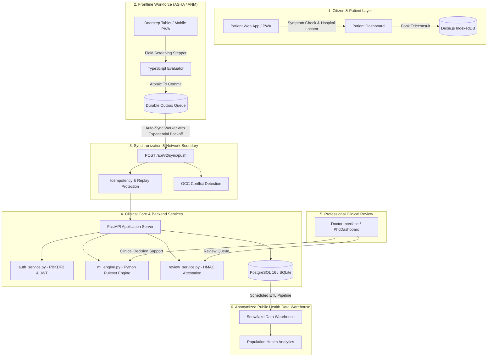

# RapiDChecK System Architecture

## 1. High-Level System Architecture

RapiDChecK is designed as a hybrid offline-first platform connecting citizens, frontline ASHA/ANM health workers, Primary Health Centre (PHC) medical officers, and district administrators.

---

## 2. Architectural Layers & Responsibilities

### Layer 1: Client Application (Frontend PWA)
* **Framework:** React 19, Vite 8, TypeScript, Tailwind CSS.
* **Offline Storage:** Dexie.js v4 IndexedDB database (`ruralhealth_offline_v4`) implementing durable outbox queues, client-generated UUIDs, client sequence numbers, and soft-delete tombstones.
* **Internationalization:** Multi-language context supporting English (`en`), Hindi (`hi`), and Bengali (`bn`) with zero translation drift.
* **Two Discrete User Experiences:**
  1. **Citizen / Patient Experience:** Symptom checker, nearby hospital locator, teleconsultation booking, health assistant, personal and family health records.
  2. **Professional Clinical Experience:** Doorstep screening flow, medical officer triage queue, cryptographic review sealing, epidemiological analysis, IDRC referral management.

### Layer 2: Clinical Decision Engine (Online/Offline Equivalence)
* **Canonical Ruleset:** Semantic version `2.0.0` defined in [`Health-AI-main/clinical-rules/v2.0.0/`](../Health-AI-main/clinical-rules/v2.0.0/).
* **Equivalence Invariant:** The client-side TypeScript evaluator ([`evaluator.ts`](../Health-AI-main/frontend/src/clinical/evaluator.ts)) and server-side Python evaluator ([`ml_engine.py`](../Health-AI-main/backend/ml_engine.py)) evaluate the exact same rules and produce identical byte-for-byte outcomes tested against canonical golden test vectors.

### Layer 3: Application Server & REST APIs
* **Framework:** FastAPI with Python 3.11.
* **Authentication:** PBKDF2-HMAC-SHA256 password hashing (600,000 iterations), HS256 JWT tokens.
* **RBAC Enforcement:** Strict multi-role permission mapping across `PATIENT`, `ASHA_WORKER`, `PHC_DOCTOR`, `DISTRICT_OFFICER`, and `SYSTEM_ADMIN`.

### Layer 4: Persistence & Synchronization
* **Database Driver:** SQLAlchemy with PostgreSQL 16 (production) / SQLite (offline test fallback).
* **Sync Protocol (V2):**
  * Push API (`POST /api/v2/sync/push`): Atomic multi-operation batch processing, idempotency de-duplication, base server version validation for OCC conflict detection.
  * Pull API (`GET /api/v2/sync/pull`): Monotonic sequence cursor pagination (`since_seq`) returning incremental sync journal entries.
