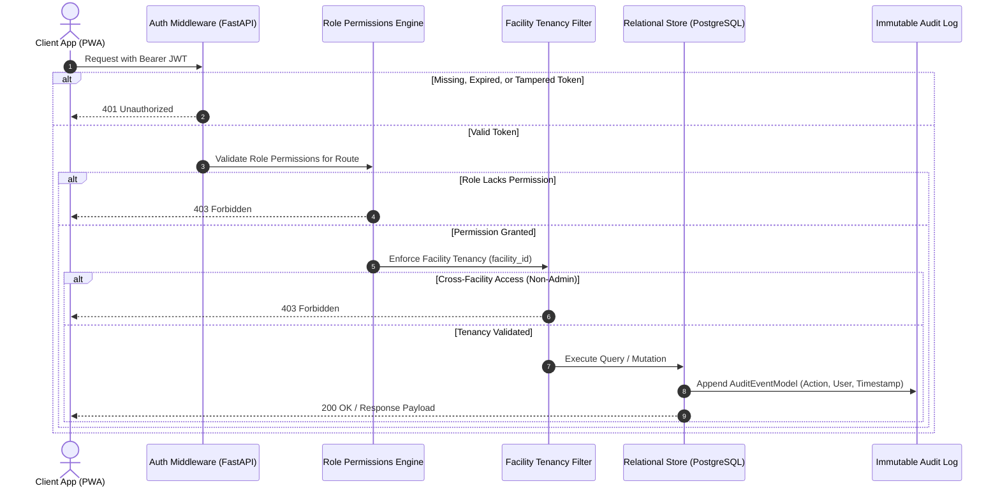

# Security & Cryptographic Architecture

## 1. Architectural Security Invariants

RapiDChecK enforces strict defense-in-depth across the entire request lifecycle.

---

## 2. Password Hashing & Key Derivation
* **Algorithm:** PBKDF2-HMAC-SHA256
* **Iterations:** 600,000 (compliant with OWASP / NIST SP 800-63B standards)
* **Salt:** 16 bytes of cryptographically secure random entropy per user via `secrets.token_bytes(16)`.
* **Storage Format:** `$pbkdf2-sha256$600000$<salt_hex>$<hash_hex>`

---

## 3. Role-Based Access Control (RBAC) Matrix

| Permission | `PATIENT` | `ASHA_WORKER` | `PHC_DOCTOR` | `DISTRICT_OFFICER` | `SYSTEM_ADMIN` |
|---|:---:|:---:|:---:|:---:|:---:|
| `patients:read` | Authorized (Self) | Authorized (Assigned Villages) | Authorized (Facility) | Authorized (District) | Authorized (All) |
| `patients:write` | ❌ | Authorized | Authorized | ❌ | Authorized |
| `assessments:create` | Authorized | Authorized | Authorized | ❌ | Authorized |
| `assessments:review` | ❌ | ❌ | Authorized | Authorized | Authorized |
| `analytics:read` | ❌ | ❌ | Authorized (Facility) | Authorized (District) | Authorized (All) |
| `system:admin` | ❌ | ❌ | ❌ | ❌ | Authorized |

---

## 4. Cryptographic Review Attestation
When a medical officer approves or modifies a clinical triage assessment:
$$\text{Signature} = \text{HMAC-SHA256}(K_{\text{review}}, \text{review\_id} \parallel \text{assessment\_id} \parallel \text{doctor\_id} \parallel \text{decision} \parallel \text{timestamp})$$
* This 64-character hexadecimal signature is permanently stored in `ClinicalReviewModel.signature_hash`.
* Any subsequent tampering with the assessment record invalidates the signature hash upon audit.
